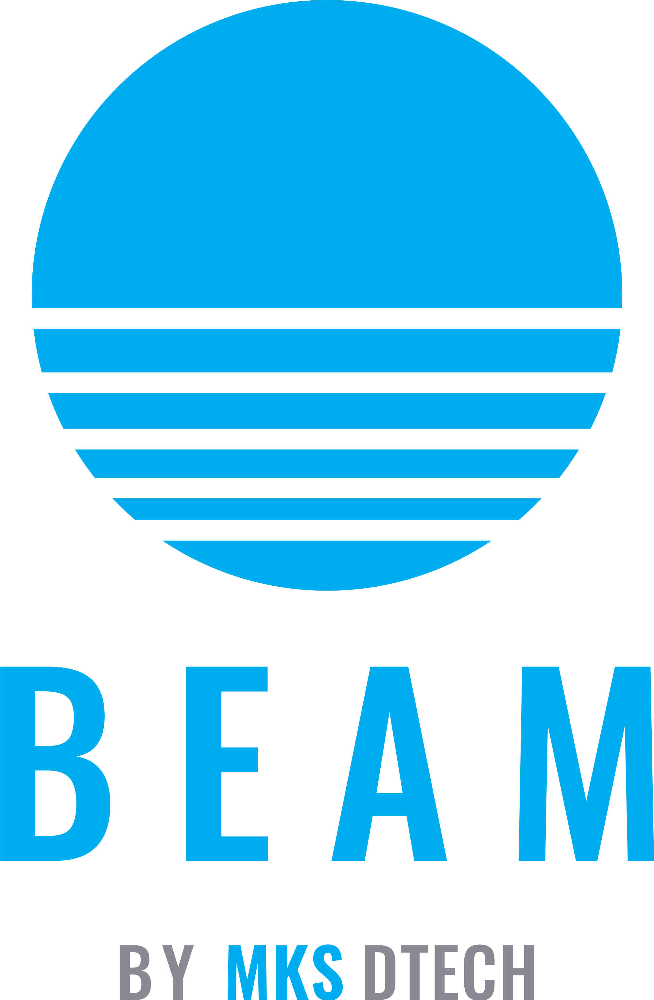

  

# BEAM
## Rhino and BIM interoperability tool

BEAM brings BIM data into Rhino. Assign categories, families, types, parameters and materials to Rhino geometry, then connect it with Revit and IFC workflows.

- [Product page](https://mksdtech.com/products/beam)
- [Download](https://mksdtech.com/downloads?product=beam)
- [Wiki](https://wiki.mksdtech.com)
- [Changelog](https://wiki.mksdtech.com/changelog)
- [Licence](https://mksdtech.com/legal/beam-license)
- [Contact](https://mksdtech.com/contact)

